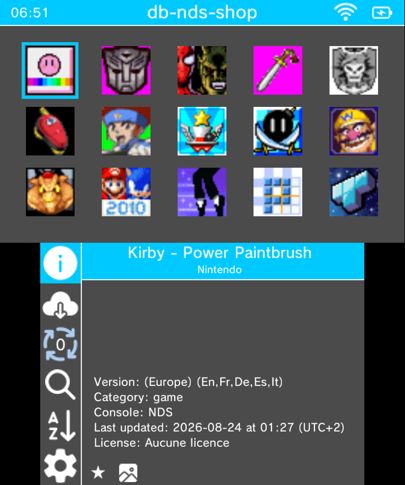
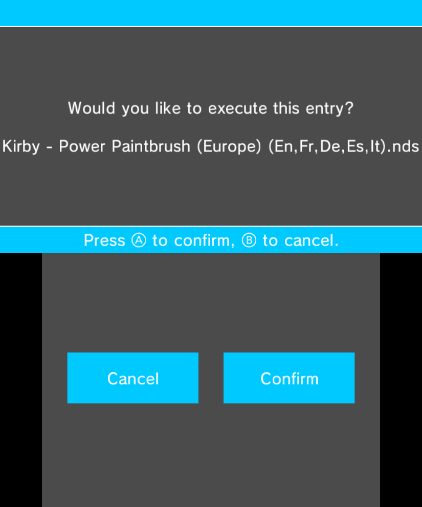
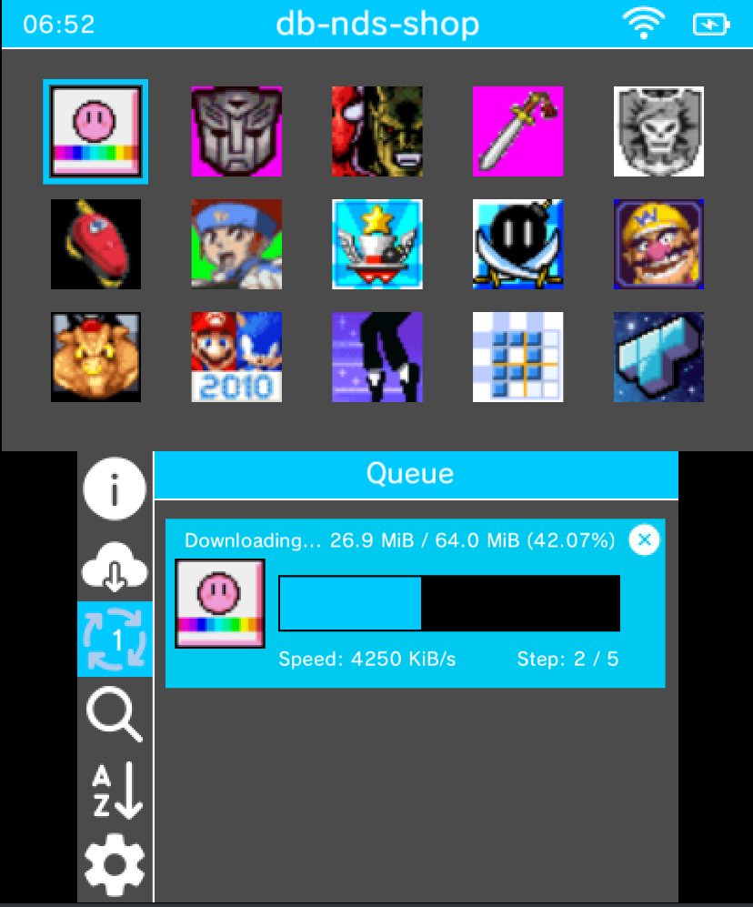
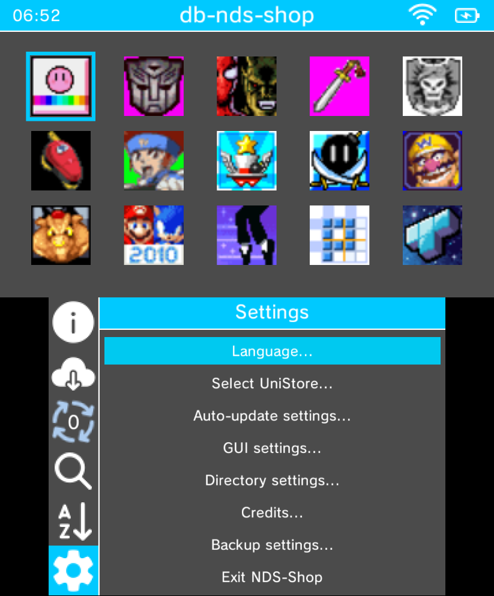

# NDS-Shop (3DS)

> An alternative Nintendo DS shop for the Nintendo 3DS family of systems.

## Features

- Browse and search a curated database of NDS games
- Download `.cia` / `.3dsx` directly to SD card
- ZIP file extraction
- Database loading via URL or file
- Multiple database support
- Automatic update check
- Customizable color scheme
- Multi-language support (EN, FR, NL, IT)

## Download

### 3DS

#### Requirements
- A modded Nintendo 3DS (XL) / 2DS (XL)
- An SD card with at least 500 MB for game installation

#### Latest release
- [latest release](https://github.com/NDS-Shop-Homebrew/NDS-Shop/releases/latest) — grab the `.cia` or `.3dsx` asset

## Building

### 3DS

Requires [devkitARM](https://devkitpro.org/wiki/Getting_Started) + [makerom](https://github.com/3DSGuy/Project_CTR) + [bannertool](https://github.com/Epicpkmn11/bannertool).

```bash
git clone --recursive https://github.com/NDS-Shop-Homebrew/NDS-Shop.git
cd NDS-Shop
make
```

Output: `NDS-Shop.3dsx` and `NDS-Shop.cia`

## Screenshots

### 3DS

<table>
<tr>
<td align="center"><b>Home</b></td>
<td align="center"><b>Browse</b></td>
<td align="center"><b>Queue</b></td>
</tr>
<tr>
<td></td>
<td></td>
<td></td>
</tr>
</table>

<table>
<tr>
<td align="center"><b>Settings</b></td>
</tr>
<tr>
<td></td>
</tr>
</table>

## DSi Version

The DSi port is maintained in a separate repository: [NDS-Shop-DSi](https://github.com/NDS-Shop-Homebrew/NDS-Shop-DSi)

## Credits

Based on [Universal-Updater](https://github.com/Universal-Team/Universal-Updater) by Universal-Team.
Database: [UDB-Kekatsu-DS](https://github.com/cavv-dev/UDB-Kekatsu-DS).