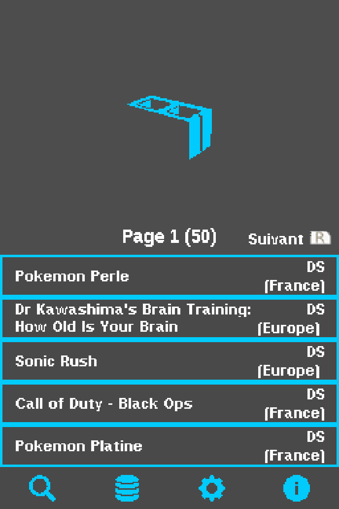
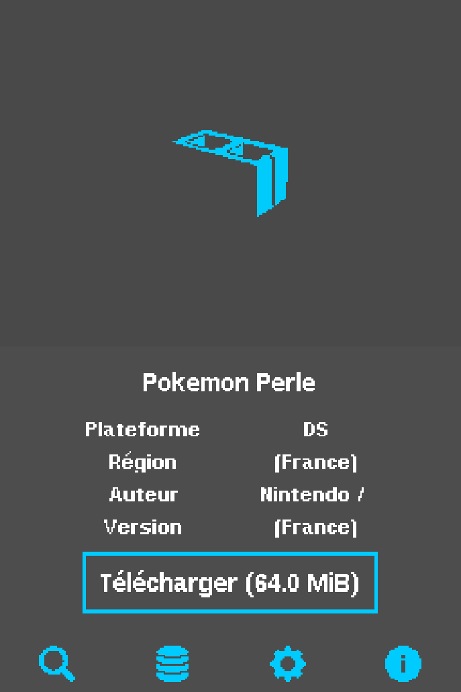
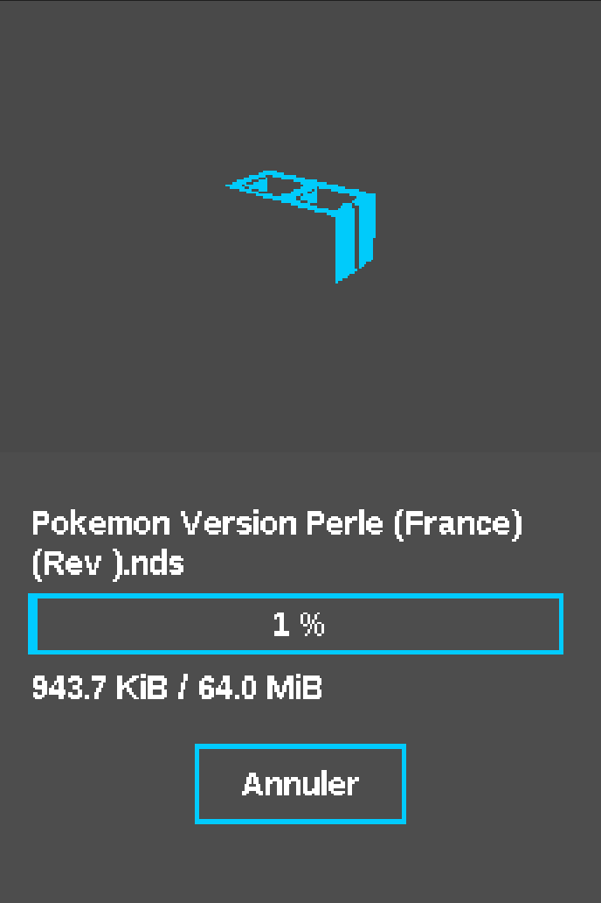

# NDS-Shop

> Un magasin alternatif pour Nintendo DS, conçu pour les consoles Nintendo DS, DSi et 3DS.

## Fonctionnalités

- Parcourir et rechercher une base de données de jeux NDS
- Télécharger les `.nds` / `.cia` directement sur la carte SD
- Téléchargement multi-plateformes (DSi + 3DS)
- Extraction de fichiers ZIP
- Chargement de bases de données via URL ou fichier
- Support de plusieurs bases de données
- Vérification automatique des mises à jour
- Schéma de couleurs personnalisable
- Support multi-langues (EN, FR, NL, IT)

## Téléchargement

### DSi

- Téléchargez `NDS-Shop.nds` depuis la [dernière release](https://github.com/NDS-Shop-Homebrew/NDS-Shop/releases/latest).
- Placez-le n'importe où sur votre carte SD.
- Lancez via TWiLight Menu++ ou Unlaunch.

### 3DS

#### Prérequis
- Une Nintendo 3DS (XL) / 2DS (XL) modifiée
- Une carte SD d'au moins 500 Mo pour l'installation des jeux

#### Dernière release
- [dernière release](https://github.com/NDS-Shop-Homebrew/NDS-Shop/releases/latest) — récupérez le fichier `.cia` ou `.3dsx`

## Compilation

### DSi

Nécessite [Wonderful Toolchain](https://wonderful.asie.pl/) + BlocksDS.

#### Installer les dépendances

Suivez le [guide officiel BlocksDS Windows](https://blocksds.skylyrac.net/docs/setup/windows/) :

```bash
# Ajouter le dépôt BlocksDS
wf-pacman -Syu wf-tools
wf-config repo enable blocksds
wf-pacman -Syu

# Installer la toolchain ARM et BlocksDS
wf-pacman -S blocksds-toolchain

# Optionnel : docs et exemples
wf-pacman -S blocksds-docs
```

#### Compilation

```bash
git clone --recursive https://github.com/NDS-Shop-Homebrew/NDS-Shop.git
cd NDS-Shop
python build.py
```

Utilisez `python build.py release` pour output dans `DSi/release/`.
Ou utilisez `compile_dsi.bat` / `clean_dsi.bat` sous Windows.

### 3DS

Nécessite devkitPro + libctru + 3ds-curl + 3ds-libarchive.

```bash
# Installer les dépendances
(dkp-)pacman -S devkitARM libctru 3ds-curl 3ds-libarchive

# Cloner et compiler
git clone --recursive https://github.com/NDS-Shop-Homebrew/NDS-Shop.git
cd NDS-Shop
make
```

Ou utilisez `compile_3ds.bat` / `clean_3ds.bat` sous Windows.

## Captures d'écran

### DSi

<table>
<tr>
<td align="center"><b>Accueil</b></td>
<td align="center"><b>Parcourir</b></td>
<td align="center"><b>Paramètres</b></td>
</tr>
<tr>
<td></td>
<td></td>
<td></td>
</tr>
</table>

### 3DS

<table>
<tr>
<td align="center"><b>Accueil</b></td>
<td align="center"><b>Parcourir</b></td>
<td align="center"><b>File d'attente</b></td>
</tr>
<tr>
<td></td>
<td></td>
<td></td>
</tr>
</table>

<table>
<tr>
<td align="center"><b>Paramètres</b></td>
</tr>
<tr>
<td></td>
</tr>
</table>

## Crédits

Basé sur [Kekatsu DS](https://github.com/cavv-dev/Kekatsu-DS) par cavv.
Base de données : [UDB-Kekatsu-DS](https://github.com/cavv-dev/UDB-Kekatsu-DS).
Concept inspiré par [pkgi-psp](https://github.com/bucanero/pkgi-psp) et [Universal-Updater](https://github.com/Universal-Team/Universal-Updater).
