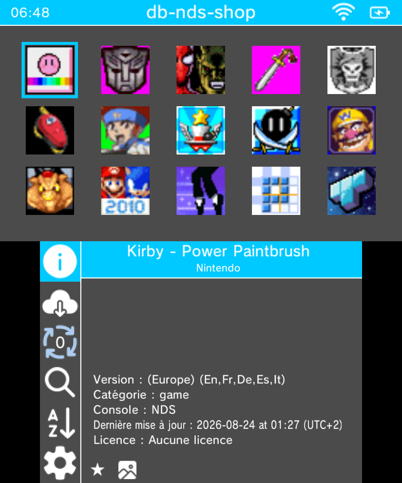
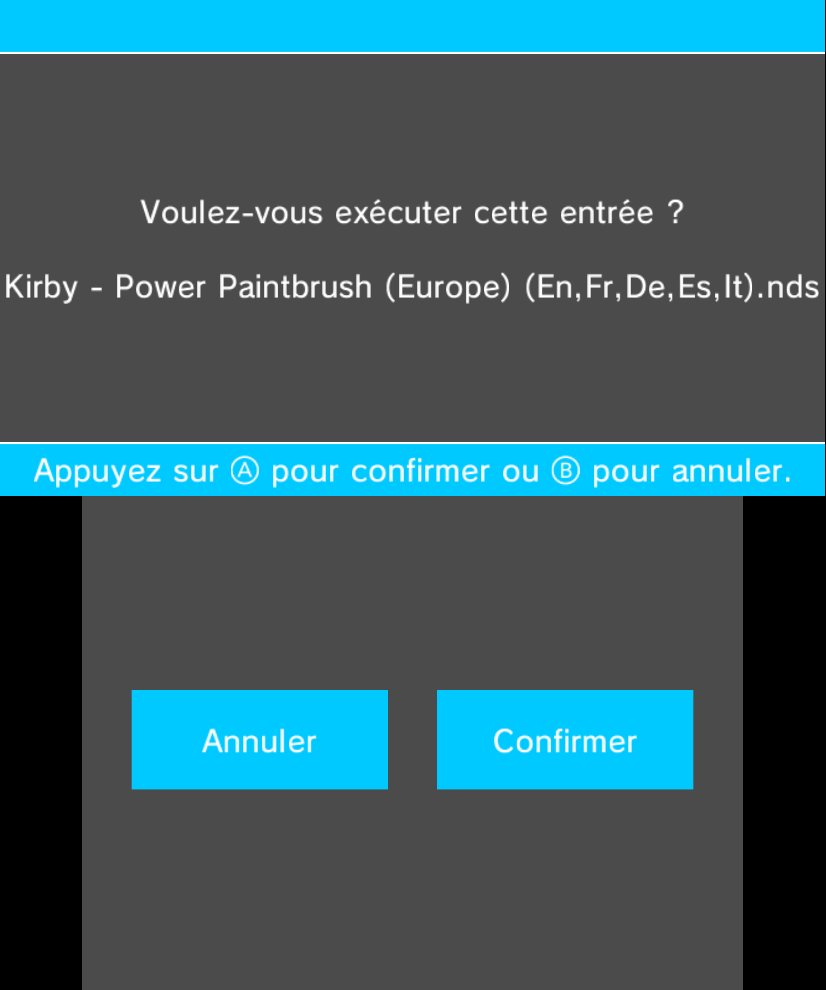
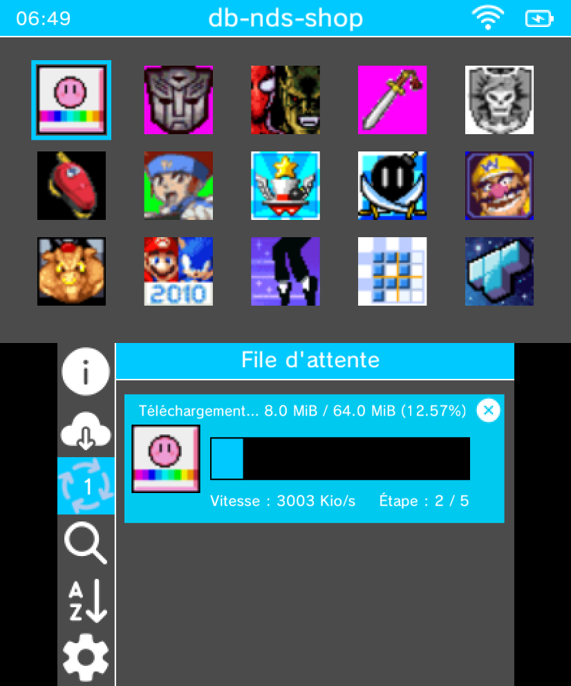
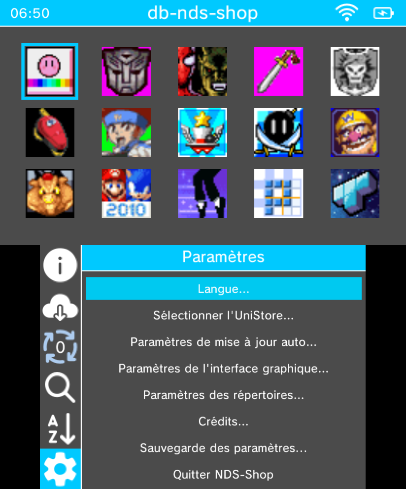

# NDS-Shop (3DS)

> Un magasin alternatif pour Nintendo DS, conçu pour la famille Nintendo 3DS.

## Fonctionnalités

- Parcourir et rechercher une base de données de jeux NDS
- Télécharger les `.cia` / `.3dsx` directement sur la carte SD
- Extraction de fichiers ZIP
- Chargement de bases de données via URL ou fichier
- Support de plusieurs bases de données
- Vérification automatique des mises à jour
- Schéma de couleurs personnalisable
- Support multi-langues (EN, FR, NL, IT)

## Téléchargement

### 3DS

#### Prérequis
- Une Nintendo 3DS (XL) / 2DS (XL) modifiée
- Une carte SD d'au moins 500 Mo pour l'installation des jeux

#### Dernière release
- [dernière release](https://github.com/NDS-Shop-Homebrew/NDS-Shop/releases/latest) — récupérez le fichier `.cia` ou `.3dsx`

## Compilation

### 3DS

Nécessite [devkitARM](https://devkitpro.org/wiki/Getting_Started) + [makerom](https://github.com/3DSGuy/Project_CTR) + [bannertool](https://github.com/Epicpkmn11/bannertool).

```bash
git clone --recursive https://github.com/NDS-Shop-Homebrew/NDS-Shop.git
cd NDS-Shop
make
```

Sortie : `NDS-Shop.3dsx` et `NDS-Shop.cia`

## Captures d'écran

### 3DS

<table>
<tr>
<td align="center"><b>Accueil</b></td>
<td align="center"><b>Parcourir</b></td>
<td align="center"><b>File d'attente</b></td>
</tr>
<tr>
<td></td>
<td></td>
<td></td>
</tr>
</table>

<table>
<tr>
<td align="center"><b>Paramètres</b></td>
</tr>
<tr>
<td></td>
</tr>
</table>

## Version DSi

Le port DSi est maintenu dans un dépôt séparé : [NDS-Shop-DSi](https://github.com/NDS-Shop-Homebrew/NDS-Shop-DSi)

## Crédits

Basé sur [Universal-Updater](https://github.com/Universal-Team/Universal-Updater) par Universal-Team.
Base de données : [UDB-Kekatsu-DS](https://github.com/cavv-dev/UDB-Kekatsu-DS).